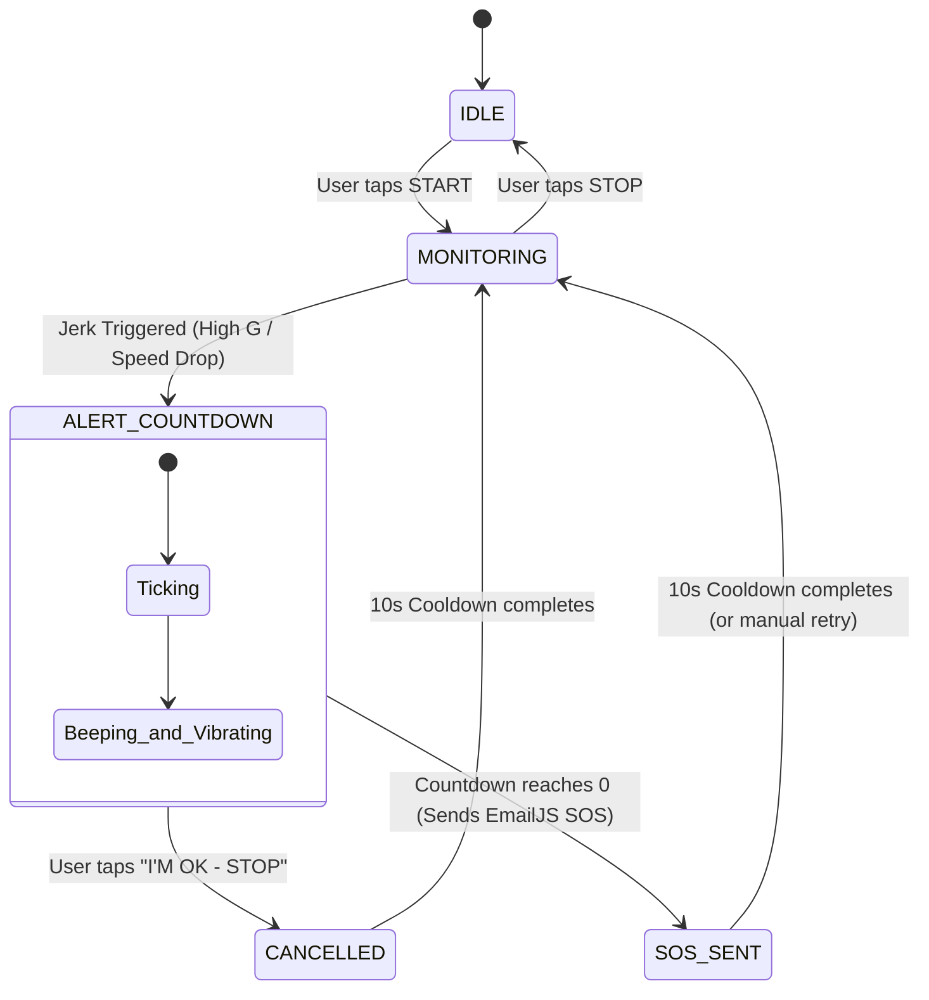

# JerkGuard 🛡️

**JerkGuard** is a mobile safety application built with Expo (React Native & TypeScript). It continuously analyzes device motion sensors and GPS telemetry to detect sudden physical jerks (such as vehicular collisions, bicycle falls, or severe impacts). Upon detection, it initiates a high-urgency audiovisual countdown, providing the user an opportunity to cancel if unhurt. If the countdown elapses, it automatically dispatches an emergency SOS alert containing GPS coordinates and incident telemetrics via the EmailJS REST API — without requiring any custom backend infrastructure.

---

## 🏗️ State Machine Architecture

JerkGuard is architected as an explicit 5-state deterministic finite state machine (FSM):



### State Definitions
1. **`IDLE`**: App is open, sensors are powered off, awaiting user activation.
2. **`MONITORING`**: Accelerometer streams at ~50 Hz and GPS watches at 1 Hz. Screen awake lock active.
3. **`ALERT_COUNTDOWN`**: High-impact event triggered. Screen transforms into high-contrast red alert; loud beep loops even in silent mode; haptic/vibration patterns pulse; large countdown displays.
4. **`CANCELLED`**: User confirmed safety by pressing **"I'M OK — STOP"**. Incident is logged, alarm halted, 10-second cooldown initiated to prevent immediate re-triggering.
5. **`SOS_SENT`**: Countdown expired. High-accuracy one-shot GPS location is fetched (5 s timeout) and SOS dispatch is executed with automated retry.

---

## 📂 Project Directory Structure

```text
jerkguard/
├── assets/
│   ├── beep.wav                     # Programmatically generated 880Hz alert tone
│   ├── icon.png
│   ├── splash-icon.png
│   └── adaptive-icon.png
├── scripts/
│   └── generate-beep.js             # Standalone sine-wave audio generator
├── src/
│   ├── config.ts                    # Central thresholds & tuning with comments
│   ├── theme.ts                     # Light and Dark theme system tokens
│   ├── types.ts                     # Shared TypeScript interfaces & types
│   ├── components/
│   │   └── LiveChart.tsx            # Real-time SVG chart (G-force & Speed)
│   ├── detection/
│   │   ├── jerkDetector.ts          # Pure mathematical detection logic
│   │   └── index.ts                 # Detection module barrel export
│   ├── hooks/
│   │   ├── useAlertCountdown.ts     # Audio (expo-audio), haptics, email dispatch
│   │   └── useMonitoring.ts         # Sensor lifecycle (expo-sensors, expo-location)
│   ├── screens/
│   │   ├── HomeScreen.tsx           # Status chip, live gauges, chart, alert modal
│   │   ├── SettingsScreen.tsx       # Contacts, countdown, sensitivity, simulator
│   │   └── LogScreen.tsx            # Incident history & log management
│   ├── services/
│   │   └── emailService.ts          # EmailJS REST API client with auto-retry
│   └── state/
│       └── AppContext.tsx           # State machine context + AsyncStorage
├── .env                             # Local environment secrets (ignored by git)
├── .env.example                     # Environment template
├── app.json                         # Expo configuration (permissions, plugins)
├── package.json
├── tsconfig.json
└── README.md
```

---

## ⚡ Quick Start: Running in Expo Go

This project is 100% compatible with standard **Expo Go** on Android and iOS (no custom dev builds or native compilation required).

### 1. Prerequisites
- Node.js (v18 or higher)
- **Expo Go** app installed on your physical device (available in Google Play Store & Apple App Store)

### 2. Installation
Navigate into the `jerkguard` directory and install dependencies:
```bash
cd jerkguard
npm install
```

### 3. Generate Audio Asset (if needed)
A clean, loud 880 Hz PCM WAV audio asset is pre-generated in `assets/beep.wav`. If you ever need to recreate it:
```bash
node scripts/generate-beep.js
```

### 4. Start the Development Server
```bash
npx expo start
```
- A QR code will display in your terminal and Metro Dev Tools in your browser.
- **Android**: Open the **Expo Go** app and tap **"Scan QR code"**.
- **iOS**: Open the native **Camera** app, point it at the QR code, and tap the Expo Go banner.

---

## 📧 EmailJS Setup (Zero-Backend SOS Dispatch)

JerkGuard communicates directly with the **EmailJS REST API** (`https://api.emailjs.com/api/v1.0/email/send`) from the client. No server, cloud function, or SMTP library is required.

### Step 1: Create an EmailJS Account
1. Sign up for free at [https://www.emailjs.com](https://www.emailjs.com).
2. Note your **Public Key** under **Account** → **API Keys** (this is your `user_id`).

### Step 2: Add an Email Service
1. Go to **Email Services** → **Add New Service**.
2. Select **Gmail** (or Outlook/Yahoo), connect your account, and click **Create Service**.
3. Note your **Service ID** (e.g., `service_abc123`).

### Step 3: Create an Email Template
1. Go to **Email Templates** → **Create New Template**.
2. Note your **Template ID** (e.g., `template_xyz789`).
3. Set the **To Email** field to:
   ```text
   {{to_email}}
   ```
4. Set the **Subject** to:
   ```text
   🚨 JERKGUARD EMERGENCY ALERT - {{user_name}}
   ```
5. Set the **Content / Body** to:
   ```html
   <h2>🚨 EMERGENCY ALERT: Potential Impact Detected</h2>
   <p><strong>User:</strong> {{user_name}}</p>
   <p><strong>Incident Time:</strong> {{time}}</p>
   <p><strong>Peak G-Force:</strong> {{peak_g}} g</p>
   <p><strong>Recorded Speed:</strong> {{speed_kmh}} km/h</p>
   <p><strong>GPS Location:</strong> <a href="{{maps_link}}">{{maps_link}}</a></p>
   <p><strong>Details:</strong> {{message}}</p>
   <hr/>
   <p><em>This automated alert was dispatched by JerkGuard Mobile.</em></p>
   ```

### Step 4: Enable Non-Browser API Access (Crucial!)
Because React Native mobile apps send requests with native headers rather than browser origins:
1. In your EmailJS Dashboard, navigate to **Security**.
2. Under **Allow EmailJS API for non-browser applications**, check **Enabled**.
3. Save changes.

### Step 5: Configure `.env`
In `jerkguard/.env`, provide your credentials:
```env
EXPO_PUBLIC_EMAILJS_USER_ID=your_public_key_here
EXPO_PUBLIC_EMAILJS_SERVICE_ID=your_service_id_here
EXPO_PUBLIC_EMAILJS_TEMPLATE_ID=your_template_id_here
```

### Step 6: Verify in App
Open **Settings** in JerkGuard, enter your emergency email, and tap **"📧 Send Test Email"**. You will receive an instant test email confirming the pipeline is active.

---

## 🎯 Jerk Detection Algorithm & Threshold Tuning

All tunable constants are centralized and annotated in [src/config.ts](file:///c:/Users/1anad/OneDrive/Desktop/App%20dev%20project/jerkguard/src/config.ts).

### Mathematical Principles
1. **Raw Magnitude in g**:
   $$\text{magnitude} = \frac{\sqrt{x^2 + y^2 + z^2}}{9.81}$$
   - At rest, gravity produces $\approx 1.0\text{ g}$.
2. **Noise Reduction (Moving Average)**:
   - A moving average filter over 4 samples (80 ms window at 50 Hz) eliminates sensor noise while retaining responsiveness to shock waves.
3. **Dual-Trigger Verification**:
   - **Accelerometer Threshold**:
     - **Low (3.5 g)**: Configured for vehicular impacts and hard crashes; ignores daily bumps.
     - **Medium (2.5 g)**: Detects hard phone drops, bike spills, and sudden jolts.
     - **High (1.8 g)**: Sensitive trigger ideal for classroom demonstrations and gentle shakes.
   - **GPS Speed Drop Indicator**:
     - Detects deceleration $\ge 30\text{ km/h}$ within a 2.0-second sliding window ($\approx 8.3\text{ m/s}^2$).
   - **Indoor Graceful Degradation**:
     - If location access is denied or GPS is lost indoors, JerkGuard automatically falls back to single-sensor accelerometer trigger and displays a notice banner.

---

## 📱 Testing Without Shaking the Phone

For presentations, live demos, or grading:
1. Navigate to the **Home** tab and tap **START**.
2. Switch to the **Settings** tab.
3. Tap **"💥 Simulate Jerk"**.
4. The application immediately enters the full-screen **`ALERT_COUNTDOWN`** screen with audible beeping and haptics.
5. Tap **"I'M OK — STOP"** to demonstrate cancellation and the 10-second cooldown, or let it expire to demonstrate automatic email dispatch!

---

## ⚠️ Known Limitations (For Academic Context)

1. **Foreground Execution in Expo Go**:
   - Expo Go restricts background sensor processing. The application keeps the display awake via `expo-keep-awake` while monitoring is active.
2. **Indoor GPS Attenuation**:
   - GPS satellites require line-of-sight. Indoors, speed reads 0 km/h; the algorithm seamlessly falls back to pure accelerometer detection.
3. **Platform Silent Mode**:
   - Handled via `expo-audio`'s `setAudioModeAsync({ playsInSilentMode: true })`. On iOS, ensure system volume is turned up to hear the tone.
